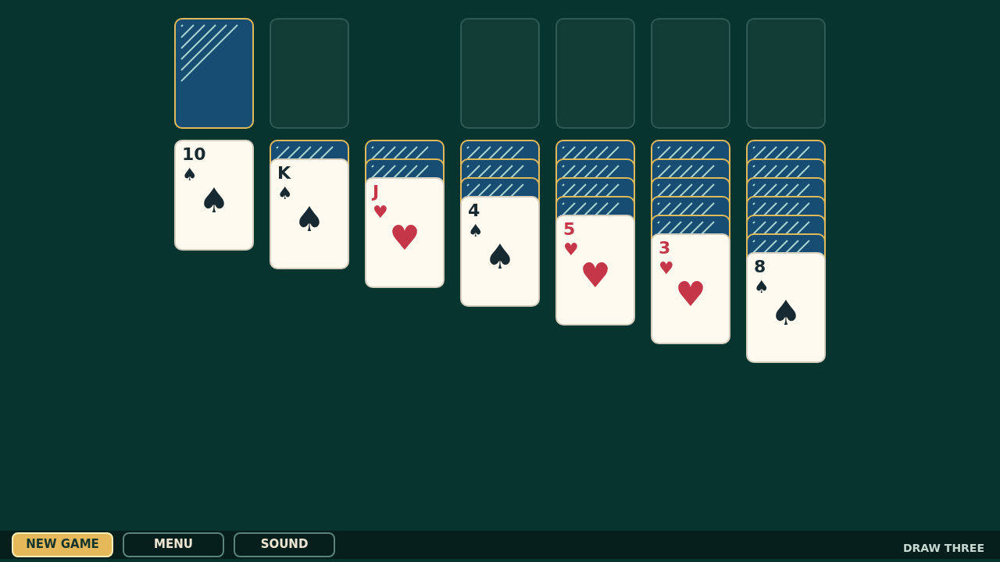

# Cascade

Cascade is Draw Three Klondike on a deep green felt table: turn sets from the stock, uncover the seven columns, and build each suit from Ace through King.

Move single cards or whole descending, alternating-color runs. A King alone opens an empty column, while a quick double-click sends an available card straight home.

The quiet table saves its spectacle for the finish. Place the final King and every foundation card launches into a bouncing cascade, leaving a bright, overlapping trail across the felt.

